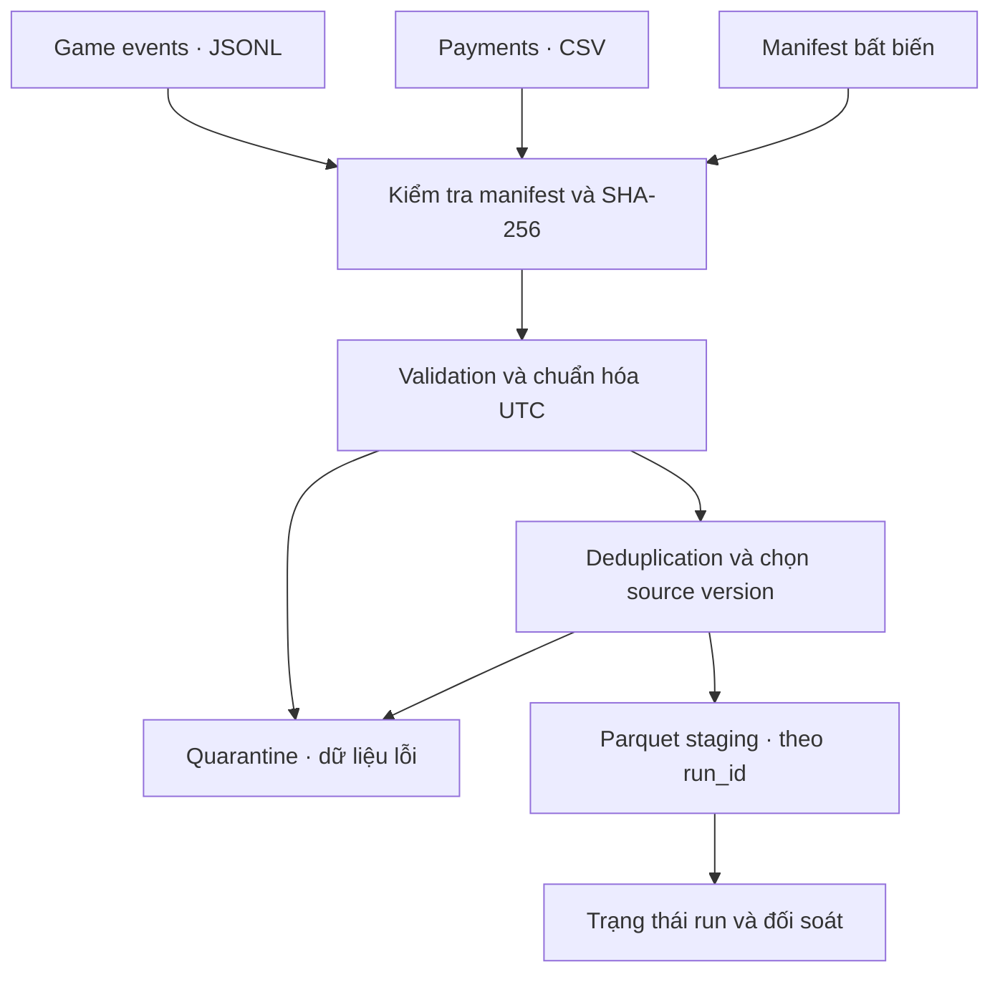
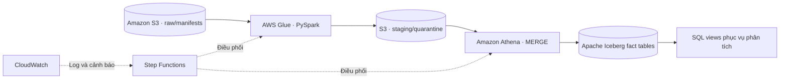

# Game Analytics Data Platform

**Nền tảng xử lý dữ liệu theo lô (batch) phục vụ phân tích hành vi người chơi và giao dịch trong game mobile, được thiết kế để triển khai trên AWS.**

Dự án xây dựng pipeline từ dữ liệu sự kiện và giao dịch giả lập, tập trung vào **chất lượng dữ liệu, xử lý dữ liệu đến muộn, chạy lại an toàn và khả năng truy vết từng lần xử lý**. Dữ liệu đầu ra phục vụ các phân tích như tỷ lệ người chơi quay lại (retention), tỷ lệ hoàn thành màn chơi và doanh thu sau hoàn tiền.

> **Trạng thái triển khai:** Pipeline PySpark local và bộ kiểm thử tự động đã hoàn thành. Hệ thống trên AWS (S3, Glue, Iceberg, Athena và Step Functions) thuộc giai đoạn triển khai tiếp theo; hiện chưa có pipeline cloud đang vận hành.

## 1. Bài toán

Game mobile phát sinh liên tục các sự kiện chơi game và giao dịch. Trong thực tế, file dữ liệu có thể **đến muộn, bị gửi lại, chứa bản ghi được cập nhật hoặc dữ liệu không hợp lệ**. Nếu chỉ nối thêm dữ liệu từ các file đầu vào, hệ thống có thể đếm trùng giao dịch, dùng phiên bản cũ ghi đè phiên bản mới hoặc ghi nhận tiền hoàn vào sai ngày.

Pipeline được thiết kế theo bốn nguyên tắc:

- **Đầu vào có thể tái lập:** Mỗi batch chỉ đọc những file nằm trong manifest đã chốt; xác minh tính toàn vẹn bằng SHA-256.
- **Biến đổi đáng tin cậy:** Sử dụng schema tường minh, kiểm tra quy tắc nghiệp vụ, cách ly dữ liệu lỗi, khử trùng lặp và xử lý phiên bản bản ghi.
- **Thực thi có thể truy vết:** Mỗi lần chạy có `run_id`, dữ liệu staging, trạng thái và số liệu đối soát riêng.
- **Ghi nhận đúng thời điểm nghiệp vụ:** Các chỉ số sử dụng `event_date` theo UTC, không dựa vào ngày file đến (`arrival_date`).

## 2. Kiến trúc hệ thống

### Pipeline local — đã triển khai



### Kiến trúc AWS — dự kiến



Giai đoạn AWS sẽ bổ sung **MERGE theo phiên bản vào Iceberg**, xử lý cập nhật giữa các batch, điều phối workflow và kiểm thử phục hồi trên cloud. Các chức năng này **chưa được tính là hoàn thành** trong phiên bản local.

## 3. Dữ liệu và chỉ số phân tích

### Dữ liệu đầu vào

| Nguồn | Khóa nghiệp vụ | Các loại sự kiện |
| --- | --- | --- |
| `game_events.jsonl` | `event_id` | `session_start`, `level_start`, `level_complete` |
| `payments.csv` | `payment_event_id` | `purchase`, `refund` |

Mô hình dữ liệu đích gồm `fact_game_event`, `fact_payment_event`, `dim_date` và các view phục vụ phân tích. **Phiên bản hiện tại mới tạo Parquet staging đã được kiểm tra; chưa tạo các bảng fact Iceberg trên AWS.**

| Chỉ số | Định nghĩa |
| --- | --- |
| **D1 / D7 Retention** | Tỷ lệ người chơi thuộc cohort ngày đầu tiên quay lại đúng ngày thứ 1 / thứ 7; chỉ tính khi đủ thời gian quan sát |
| **Level Completion Rate** | Số người hoàn thành màn sau khi bắt đầu / số người bắt đầu màn trong cùng cửa sổ báo cáo |
| **Net Revenue** | Tổng tiền mua trừ tổng tiền hoàn, phân bổ theo `event_date` (UTC) |

### Kịch bản minh họa: hoàn tiền đến muộn

| Ngày nhận file | Sự kiện | Kết quả kỳ vọng |
| --- | --- | --- |
| **01/11/2026** | P01 và P02 bắt đầu chơi; P01 mua vật phẩm 1.000 cent | Doanh thu ngày 01/11: **+1.000 cent** |
| **02/11/2026** | P01 quay lại và hoàn thành màn L01 | **D1 = 50%**, hoàn thành L01 = **100%** |
| **03/11/2026** | Nhận refund 300 cent, nhưng `event_at` thuộc ngày 02/11 | Doanh thu ngày 02/11 được điều chỉnh thành **−300 cent** |

Chạy lại manifest ngày 01/11 với `run_id` mới vẫn cho ra dữ liệu nghiệp vụ và `payload_hash` như cũ. Điều này kiểm chứng **tính tái lập của staging**, chưa phải tính idempotent ở warehouse; tính chất đó sẽ được kiểm thử khi triển khai Iceberg MERGE.

## 4. Điểm kỹ thuật nổi bật

- **Manifest-driven ingestion:** Cố định danh sách file đầu vào, kiểm tra checksum và cấu trúc file trước ETL.
- **Data validation & quarantine:** Kiểm tra schema và quy tắc nghiệp vụ; lưu bản ghi lỗi kèm lý do và thông tin nguồn để truy vết.
- **Deduplication & source versioning:** Gộp các bản gửi lại có cùng khóa/phiên bản/nội dung; chọn phiên bản mới nhất trong manifest; dừng batch khi cùng khóa và phiên bản nhưng nội dung khác nhau.
- **Parquet staging theo `run_id`:** Tách dữ liệu và trạng thái theo từng execution; xử lý được cả nguồn có 0 bản ghi hợp lệ.
- **Đối soát và xử lý lỗi:** Kiểm tra số dòng ở từng bước, dọn dữ liệu ghi dở khi gặp lỗi thông thường ở local. Đây chưa phải cơ chế transaction nguyên tử hoặc phục hồi sau crash trên S3.
- **Automated testing:** Kiểm thử validation, checksum, version conflict, replay, refund đến muộn và các tình huống lỗi bằng `pytest`.

## 5. Công nghệ sử dụng

| Thành phần | Công nghệ |
| --- | --- |
| Xử lý dữ liệu local | Python, PySpark, Apache Parquet |
| Kiểm thử | pytest |
| Lưu trữ và ETL trên cloud *(dự kiến)* | Amazon S3, AWS Glue, Glue Data Catalog |
| Data warehouse và truy vấn *(dự kiến)* | Apache Iceberg, Amazon Athena |
| Điều phối và giám sát *(dự kiến)* | AWS Step Functions, EventBridge Scheduler, CloudWatch |

## 6. Chạy thử trên local

**Yêu cầu:** Java 17, Python và các thư viện trong `requirements.txt`.

```bash
python3 -m venv .venv
source .venv/bin/activate
python -m pip install -r requirements.txt
export PYSPARK_PYTHON="$(which python)"
export SPARK_LOCAL_IP=127.0.0.1

# Tạo dữ liệu giả lập
python src/generate_data.py

# Tạo và xác minh manifest ngày đầu
python src/create_manifest.py --batch-date 2026-11-01
python src/verify_manifest.py \
  --manifest data/manifests/batch_date=2026-11-01/manifest_001.json

# Chạy ETL (tự sinh run_id)
python src/run_local_batch.py \
  --manifest data/manifests/batch_date=2026-11-01/manifest_001.json

# Chạy kiểm thử
python -m pytest -q
```

Để thực hiện đầy đủ kịch bản ba ngày, tạo manifest và chạy batch tương tự cho `2026-11-02` và `2026-11-03`. Kết quả được lưu tại `data/staging/`, dữ liệu lỗi tại `data/quarantine/` và trạng thái từng lần chạy tại `data/runs/`.

Có thể xem thêm tham số qua `python src/run_local_batch.py --help`. File raw và manifest đã chốt được bảo vệ khỏi thao tác ghi đè âm thầm.

## 7. Cấu trúc repository

```text
src/
  generate_data.py       # Sinh fixture và các tình huống kiểm thử
  create_manifest.py     # Tạo manifest và checksum
  verify_manifest.py     # Kiểm tra tính toàn vẹn của đầu vào
  transforms.py          # Validation, payload hash, source version
  run_local_batch.py     # Điều phối batch local và ghi Parquet staging
tests/                   # Kiểm thử pipeline và logic nghiệp vụ
data/                    # Raw fixture, manifest và dữ liệu phát sinh
glue/                    # AWS Glue jobs (dự kiến)
sql/                     # Athena DDL, MERGE, views (dự kiến)
infra/                   # Hạ tầng AWS (dự kiến)
```

## 8. Lộ trình phát triển

- [x] Ingestion local cho game events và payments; manifest, checksum, validation, quarantine, deduplication và Parquet staging.
- [x] Kiểm thử replay và refund đến muộn bằng dữ liệu giả lập.
- [ ] Triển khai luồng raw → staging trên Amazon S3 và AWS Glue.
- [ ] Xây dựng bảng fact Iceberg và `MERGE INTO` theo phiên bản bằng Athena.
- [ ] Tạo các SQL views phân tích retention, tỷ lệ hoàn thành màn và doanh thu.
- [ ] Điều phối, ghi log và giám sát bằng Step Functions, CloudWatch.
- [ ] Kiểm thử replay, phục hồi và idempotency xuyên batch trên AWS.

---

*Dữ liệu trong dự án hoàn toàn là dữ liệu giả lập, không sử dụng thông tin người chơi hoặc giao dịch thật.*
